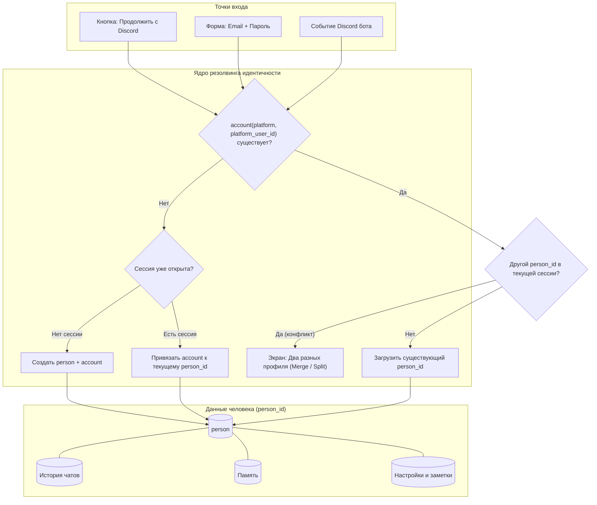

# Архитектура идентичности Neyra (Single Identity Contract)

**Статус**: Утверждённый контракт для веб-клиента (`web/`) и ядра (`server/`)  
**Дата**: 14 ноября 2026 г.  
**Контекст**: Этап 3 — Единая идентичность пользователя (Discord-first + Web)

---

## 1. Схема данных (DB Contract)

У каждого человека в системе существует ровно один внутренний идентификатор — `person_id`.  
Все внешние площадки (Discord, Web, в будущем Telegram) подключаются как привязанные аккаунты (`account`).

```sql
-- Единый субъект системы (человек)
CREATE TABLE person (
  person_id      TEXT PRIMARY KEY,              -- Формат 'u_' + 26 символов (Crockford Base32 ULID)
  display_name   TEXT NOT NULL,                 -- Имя для обращения
  avatar_url     TEXT,                          -- Ссылка на аватар
  status         TEXT NOT NULL DEFAULT 'active',-- 'active' | 'suspended' | 'deleted' | 'merged'
  merged_into    TEXT REFERENCES person(person_id), -- Если объединён с более старым профилем
  created_at     TIMESTAMPTZ NOT NULL DEFAULT NOW(),
  updated_at     TIMESTAMPTZ NOT NULL DEFAULT NOW()
);

-- Площадки и способы входа, привязанные к субъекту
CREATE TABLE account (
  account_id       TEXT PRIMARY KEY,            -- 'acc_' + ULID
  person_id        TEXT NOT NULL REFERENCES person(person_id) ON DELETE CASCADE,
  platform         TEXT NOT NULL,               -- 'discord' | 'web' | 'telegram'
  platform_user_id TEXT NOT NULL,               -- Идентификатор на площадке (Discord snowflake, Web email/sub)
  username         TEXT,                        -- Отображаемый ник на площадке
  is_primary       BOOLEAN NOT NULL DEFAULT FALSE, -- Основная площадка текущей сессии
  linked_at        TIMESTAMPTZ NOT NULL DEFAULT NOW(),
  unlinked_at      TIMESTAMPTZ,                 -- Метка отвязки (для аудита)
  CONSTRAINT uq_platform_user UNIQUE (platform, platform_user_id)
);

-- Аудит объединений профилей (с возможностью отката 30 дней)
CREATE TABLE person_merge_audit (
  merge_id            TEXT PRIMARY KEY,
  target_person_id    TEXT NOT NULL REFERENCES person(person_id), -- Сохранённый (старший)
  source_person_id    TEXT NOT NULL REFERENCES person(person_id), -- Поглощённый (младший)
  performed_by        TEXT NOT NULL,                              -- person_id инициатора (или 'system'/'admin')
  transferred_counts  JSONB NOT NULL,                             -- { accounts: 1, chats: 12, notes: 4, memory: 58 }
  merged_at           TIMESTAMPTZ NOT NULL DEFAULT NOW(),
  undone_at           TIMESTAMPTZ                                 -- Если было отменено в течение 30 дней
);
```

---

## 2. Ключевые правила системы

1. **Единственный глобальный ID**:
   - `person_id` — единственный идентификатор, используемый в API, сессиях, хранилище памяти ChromaDB/SQLite, диалогах, ролях доступа (RBAC), системных логах и заметках.
   - `platform_user_id` (например, `discord_user_id`) используется **исключительно** на границе ввода для резолвинга входящего события в `person_id`.
2. **Запрет автоматического слияния**:
   - **Никогда** не объединять профили автоматически по совпадению имени, ника или email!
   - Объединение профилей — только явное действие человека в интерфейсе или администратора, с подтверждением и записью в аудит.
3. **Разрешение входящих событий Discord**:
   - Бот получает событие с `discord_user_id`.
   - Запрос: `SELECT person_id FROM account WHERE platform = 'discord' AND platform_user_id = ? AND unlinked_at IS NULL`.
   - Если найдено → событие обрабатывается в контексте найденного `person_id`.
   - Если не найдено → атомарно создаётся `person` + `account(platform='discord')` с ролью `user`.
4. **Удаление профиля (Soft Delete)**:
   - `person.status = 'deleted'`.
   - Все активные сессии веба и Discord-моста немедленно отзываются.
   - Записи `account` не удаляются физически, а получают `unlinked_at = NOW()` для сохранения аудита.

---

## 3. Сценарии входа и привязки

| Сценарий | Последовательность действий | Результат |
| :--- | :--- | :--- |
| **1. Новый пользователь (Discord)** | Нажатие «Продолжить с Discord» → OAuth2 на стороне Discord → callback | Создаётся `person` (имя и аватар из Discord) + `account(discord)`. Роль `user`. Переход в `/onboarding`. |
| **2. Новый пользователь (Web email)** | Заполнение формы email + пароль (или инвайт) на `/login` | Создаётся `person` + `account(web)`. Роль `user`. Переход в `/onboarding`. |
| **3. Веб-пользователь подключает Discord** | Авторизован в веб-профиле → `Настройки → Аккаунты → Привязать Discord` | Если этот Discord ещё никем не занят: добавляется `account(discord)` к текущему `person_id`. Память и история остаются общими. |
| **4. Discord-пользователь заходит в веб** | Нажимает «Продолжить с Discord» в браузере | Входит в существующий `person_id`. Веб-сессия связывается с его профилем. |
| **5. Конфликт: оба профиля уже созданы независимо** | Вход через Discord, но у Discord-аккаунта уже свой `person_A`, а у веб-пользователя открыта сессия `person_B` | **Без молчаливого слияния!** Показывается экран выбора: «Похоже, это два разных профиля». Человек выбирает: объединить или остаться раздельно. |

---

## 4. Архитектурная схема потоков (Mermaid)



---

## 5. Правила объединения профилей (Merge Rules)

Мерж запускается исключительно вручную:
1. **Пользователем**: в `Настройки → Аккаунты → Объединить с другим профилем` (поиск по email/нику + подтверждение).
2. **Администратором**: в `Админка → Доступ → карточка пользователя → Объединить с…` (поиск по `person_id`/email/Discord + предпросмотр + ввод слова «объединить»).

**Механика переноса**:
- **Основной `person_id`**: сохраняется более старый по дате создания `created_at`. Второй помечается `status = 'merged'`, `merged_into = target_person_id`.
- **Аккаунты (`account`)**: все привязанные площадки перенаправляются на целевой `person_id`.
- **История и заметки**: переносятся с сохранением метаданных `origin_person_id`.
- **Память и векторные эмбеддинги**: переиндексируются на целевой `person_id`.
- **Права и роли (RBAC)**: назначается наивысшая роль из двух (например, `admin` побеждает `user`).
- **Блокировки (Bans)**: если один из профилей заблокирован, результирующий профиль остаётся заблокированным.
- **Откат 30 дней**: возможность отмены объединения через запись в `person_merge_audit` с возвратом исходных привязок.

---

## 6. Требования к реализации на стороне ядра (`server/`)

1. Добавить эндпоинты:
   - `POST /api/auth/discord/start` — генерация OAuth2 URL с защитой от CSRF (`state`).
   - `GET /api/auth/discord/callback` — обмен кода на Discord access token, получение данных пользователя Discord, поиск/создание `person` и сессионного токена.
   - `POST /api/account/link/discord` — привязка Discord к авторизованному `person_id`.
   - `DELETE /api/account/link/:account_id` — отвязка площадки (валидация: нельзя отвязать единственный способ входа).
   - `POST /api/account/merge/preview` — предпросмотр объединения двух профилей.
   - `POST /api/account/merge/execute` — атомарное объединение в транзакции БД с фиксацией в аудите.
2. В таблицах сообщений, сессий и памяти заменить любые прямые ссылки `user_id` / `discord_user_id` на внешние ключи `person_id`.
3. Сохранить обратную совместимость с legacy email-пользователями: таблица пользователей Better Auth мапится как `account(platform='web', platform_user_id=user.id)`.
